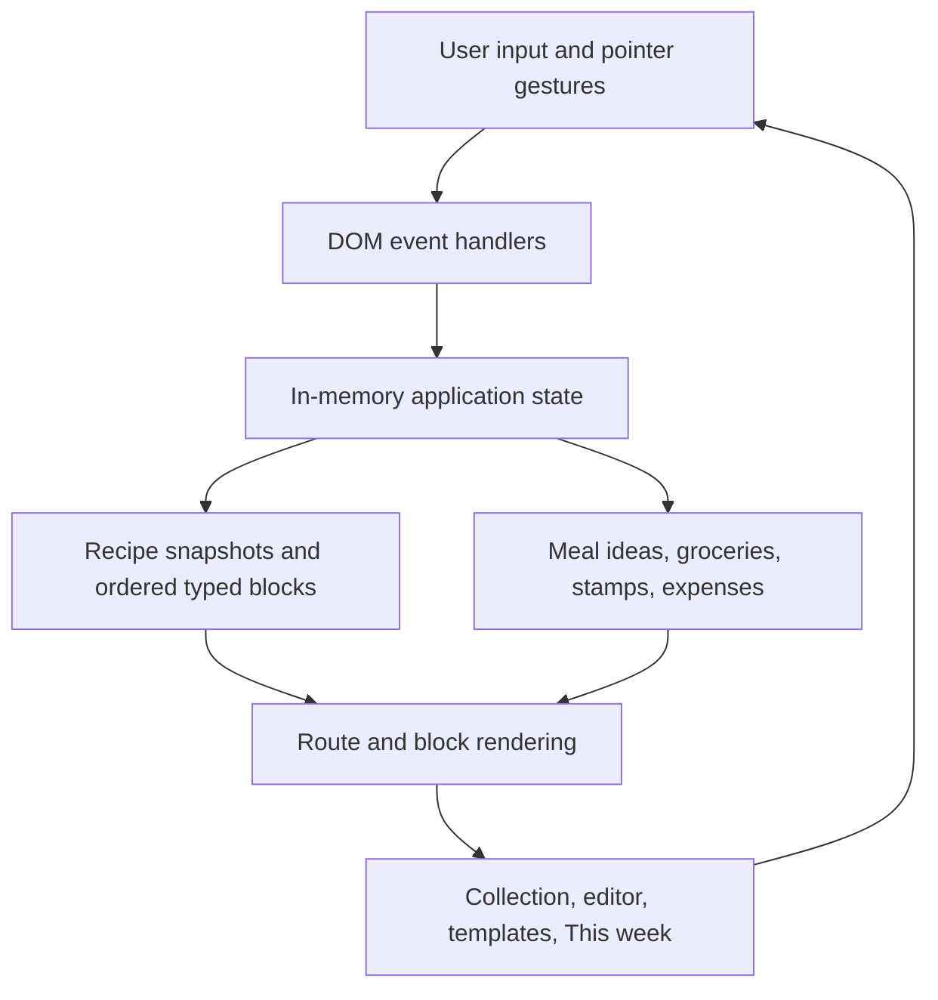

# Cuillère

**Recipe your way.**

A personal kitchen notebook for recipes, experiments, and the ideas that happen while cooking.

**Work in progress · Independent personal project by Huizi Yang · Interactive browser prototype**

> **Where the code lives:** the implementation currently lives on [`docs/product-foundation`](https://github.com/huizi135/Cuillere/tree/docs/product-foundation). The default `main` branch currently contains this project overview. Cuillère is not yet a released iOS or Android application.

## Why I Built Cuillère

I love cooking and baking, but I have struggled to find a recipe keeper that fits the way I actually use my kitchen.

Many tools organize a recipe around a predefined set of ingredients, instructions, and timings. Those details matter, but they are only part of what I want to keep. While cooking, I often want to write down a variation, sketch an idea, remember a song, or capture a thought about the day. Sometimes the note beside a recipe becomes as meaningful as the recipe itself.

I started Cuillère to give those things a place together. Inspired by Notion's modular approach, I am exploring how a cooking notebook can adapt to a person's habits instead of asking them to follow one fixed template.

This is also an opportunity to build an independent product from a real personal need: define its behavior, implement it, try it in daily life, and revise the parts that create friction.

## Product Vision

Cuillère treats a recipe as a page that can grow with its author. Ingredients and instructions provide a useful starting point; photos, writing, sketches, and experiments can sit alongside them.

The design follows four principles:

- **Compose freely.** Add and arrange content blocks rather than complete a mandatory form.
- **Keep capture lightweight.** Favor inline editing and short interactions over repeated dialogs.
- **Connect cooking with everyday life.** Keep meal inspiration, recurring groceries, and shopping totals close to the notebook.
- **Leave room to change your mind.** Meal ideas are options for the week, not a schedule to obey. Recipes have no verified/unverified status.

The current visual direction is quiet and monochrome, with rounded modules, grayscale hierarchy, and icon-led controls. Gesture discoverability and accessibility still need further work.

## Current Features

The following interactions are implemented in the browser prototype. They are exploratory, session-only features—not production or device-validated capabilities.

| Area | Implemented in the prototype |
| --- | --- |
| Recipe collection | Browse recipe cards; search titles, ingredients, and tags; filter by categories and tags. |
| Page editor | Create pages, switch between editing and preview, and add typed content blocks. New standard pages start with Ingredients and Process. |
| Modular composition | Rename module titles inline, long-press module headers to reorder, and long-press then swipe right to remove a module. |
| Ingredients | Common-ingredient shortcuts, drag-to-add, custom ingredient rows, quantities and units, limited calorie estimates, and proportional serving adjustments. |
| Process | Three initial numbered rows, inline instructions, additional steps, and optional step photos. The current editor exposes photo actions rather than time/temperature controls. |
| Writing and photos | Free-text notes for reflections or diary-style writing; local image selection for page covers and photo blocks. Covers are reused on collection cards. |
| Sketching | Canvas drawing, erasing, and stroke undo. Drawing coordinates are retained in the current page's in-memory block data. |
| Experiments | A three-attempt comparison block with editable variables, observations, and optional images. |
| Starter templates | Everyday, Baking, and Minimal page structures. Saving personal templates is not implemented. |
| This week | Meal ideas and notes, made/undo states, and reversible copying of an idea into the next week. |
| Grocery | Inline list entry, completion toggles, swipe removal, and recurring “stamp” items added through direct entry or long-press drag. |
| Spending | Shopping totals and dates, monthly aggregation, inline corrections, and a date calendar with dots on recorded shopping days. |

### Important boundaries

- **No durable application storage.** Recipe pages, groceries, expenses, images, and drawings live in JavaScript memory. Refreshing or closing the page resets them. The preview shell's own storage helpers do not persist notebook data.
- **Music is a UI demonstration.** A searchable sample-track picker attaches a selection to a page. There is no playback, music-provider connection, or real catalog search.
- **Writing is a generic text block.** It can hold a diary entry, but there is no separate journal system or diary timeline.
- **Nutrition is limited arithmetic.** A small hardcoded food table supports selected names and units. Unmatched inputs remain unknown; incomplete totals are marked partial. Initial serving counts are heuristic estimates, not nutritional guidance.
- **Media stays local to the session.** Image selection uses `FileReader` and data URLs, with no upload service or managed asset store.
- **Touch behavior is still being refined.** Implemented gestures and save flows require broader browser, keyboard, accessibility, and physical-device testing.

## Technical Stack

| Layer | Current implementation |
| --- | --- |
| Interface | HTML, CSS, and vanilla JavaScript; no application UI framework |
| Interaction | DOM events, Pointer Events, pointer capture, inline editing, and CSS transitions |
| Drawing and images | HTML Canvas 2D API and browser File API / `FileReader` |
| State | Closure-scoped JavaScript objects and arrays; page snapshots use JSON deep copies |
| Preview runtime | A standalone HTML shell embedding the fragment in a sandboxed iframe |
| Icons and runtime dependencies | Lucide icons and Floating UI loaded by the shell from CDNs |
| Build tooling | Python 3 standard library (`pathlib`, `html.escape`); no npm build step |
| Backend / database | None implemented |
| Mobile framework | Not selected; iOS and Android remain target platforms |

## Architecture Overview

The prototype deliberately keeps the implementation close to the UI while product behavior is evolving. These are logical responsibilities inside one source fragment, not separate services or production packages.



A recipe snapshot contains its title, cover, ordered blocks, categories, song selection, and serving-related state. Blocks have IDs and a type-specific payload: ingredient rows, process steps, text, drawing strokes, images, or comparison values. Navigating away from the editor snapshots the current page into the session's collection.

Weekly features use a separate in-memory structure. Meal ideas reference a week; grocery items track completion; recurring names seed new weeks; expenses store a date and integer cents. Monthly totals are derived from those records. Nutritional calculations similarly derive values from ingredient quantities rather than accept manually entered calories.

The present implementation has accumulated render wrappers, event delegation, and style overrides during iteration. Separating domain rules, state transitions, rendering, and gestures is a next engineering step—not an architecture already completed.

### Repository layout

On the implementation branch:

```text
prototype/
  source.html              Editable interface, state, and interaction logic
  index.html               Generated standalone preview
tools/
  build_prototype.py       Standard-library build script
  prototype-shell.html     Preview runtime and iframe wrapper
docs/                     Product decisions, interaction specs, engineering plans
README.md
```

The files under `docs/` include proposals and earlier design decisions. They are design history, not evidence that every described capability is implemented.

## Getting Started

### Run the checked-in preview

Requirements: Git and a modern browser. Internet access is needed for the shell's CDN dependencies. No backend, database, API keys, or package installation is required.

```bash
git clone --branch docs/product-foundation --single-branch https://github.com/huizi135/Cuillere.git
cd Cuillere
```

Open `prototype/index.html` in a browser. On Windows PowerShell:

```powershell
Start-Process .\prototype\index.html
```

The repository is currently private; cloning requires authorized GitHub access until its visibility changes.

### Edit and rebuild

Edit `prototype/source.html`, then regenerate the preview with Python 3:

```bash
python3 tools/build_prototype.py
```

On Windows:

```powershell
py .\tools\build_prototype.py
```

Refresh the browser after rebuilding. The build escapes the fragment into the shell's single placeholder and writes `prototype/index.html`. Commit both the source and generated preview when changing the prototype. Rebuilding or refreshing does not preserve session data.

[Windows walkthrough (中文)](https://github.com/huizi135/Cuillere/blob/docs/product-foundation/docs/local-prototype-guide-zh.md)

## Screenshots

No screenshots are currently committed to the repository. Run the prototype to explore the current interface; earlier design captures may differ from the latest implementation. A versioned gallery of the collection, editor, and weekly notebook is planned once the interaction baseline is stable.

## Engineering Challenges

**Flexible content without a rigid recipe schema.** Typed blocks make different kinds of content possible on one page. The next challenge is to formalize their schemas, validate payloads, and migrate saved data as block types evolve.

**Editing, dragging, and scrolling on the same surface.** A press may mean text editing, list completion, reordering, or removal. The prototype uses hold thresholds, pointer capture, and click suppression. These interactions need device tests and accessible alternatives before a mobile release.

**State consistency during rendering.** Rebuilding sections of the DOM can interrupt editing, lose drafts, or collapse an expanded stamp list. Draft preservation and expansion-state restoration address particular cases; the broader solution is a clearer state model with predictable updates.

**Quantities and incomplete calculations.** Serving adjustments must avoid cumulative rounding drift, while calorie calculations must distinguish unsupported inputs from zero. The prototype retains scaling anchors and exposes missing estimates. Broader unit conversion and data provenance remain future work.

**Persistence and media lifecycle.** JSON snapshots and data URLs make interaction experiments easy, but do not provide reliable storage. A real application needs versioned local persistence, managed media references, backup/restore, and migration tests before cloud synchronization.

**Reproducible delivery and verification.** The checked-in preview can be regenerated with a small standard-library build script. There is currently no committed automated test suite or CI workflow. Build reproducibility is not evidence that every browser interaction works; the next milestone includes regression coverage for save/edit flows and gestures.

## Roadmap

The sequence below describes intended work, not release commitments.

- [ ] Stabilize the browser prototype: consolidate render/event logic, repair interaction regressions, and test keyboard and touch behavior.
- [ ] Extract and test domain rules for quantities, scaling, incomplete estimates, spending, and typed blocks.
- [ ] Add durable local storage, versioned schemas, media handling, and export/restore.
- [ ] Evaluate a cross-platform framework through an editor-and-storage technical spike, then build an iOS/Android vertical slice.
- [ ] Add reusable user-defined templates and improve category/label consistency across the editor and collection.
- [ ] Integrate a suitable nutrition source with explicit unit support, attribution, and missing-data handling.
- [ ] Explore real music links or provider integration, and more capable sketching and personal writing workflows.
- [ ] Design optional accounts, backup, and cross-device synchronization after the local experience is reliable.
- [ ] Prepare device testing, accessibility review, and a private beta before store release.

Framework, storage engine, external providers, licensing, monetization, and launch timing are open decisions.

## Development Status

**Work in progress.** Cuillère is currently a product discovery and software prototyping project. The repository contains working interaction code and design documentation, but no production mobile application, server, database, deployment pipeline, or store release.

I am developing the product direction and implementation together, using feedback from actual prototype sessions to refine the experience. The goal is to carry the validated workflows into a maintainable application rather than treat the prototype as the finished architecture.

[Product brief](https://github.com/huizi135/Cuillere/blob/docs/product-foundation/docs/product-brief.md) · [Engineering plan — proposed](https://github.com/huizi135/Cuillere/blob/docs/product-foundation/docs/engineering-plan.md) · [Implementation source](https://github.com/huizi135/Cuillere/blob/docs/product-foundation/prototype/source.html)

## License

No project license file is currently present. No open-source license has been selected or granted for this project. Public repository visibility, if enabled later, should not be read as an open-source license. Third-party dependencies retain their respective licenses.

---

**Cuillère** is the product name; **Cuillere** is the repository identifier.
